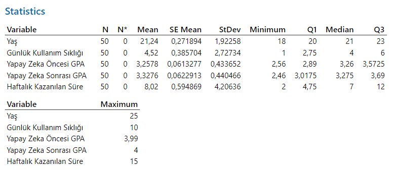
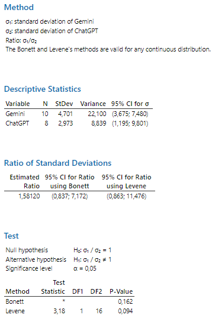
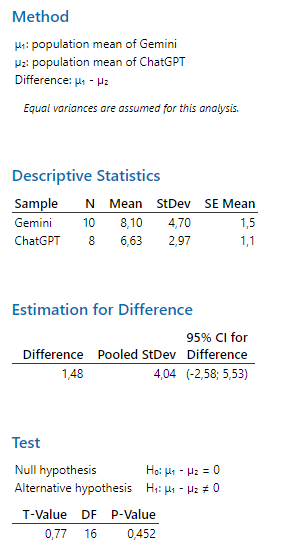
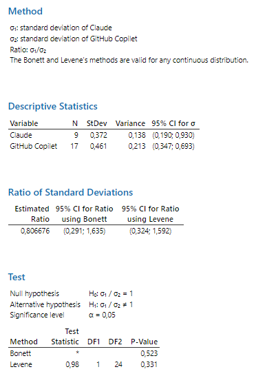
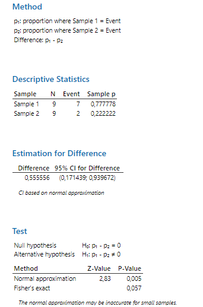
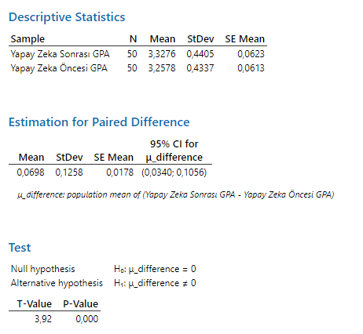
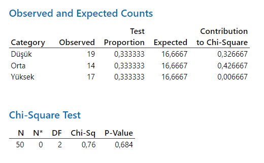
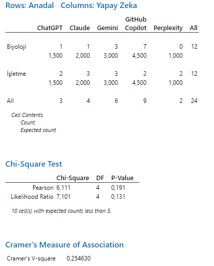
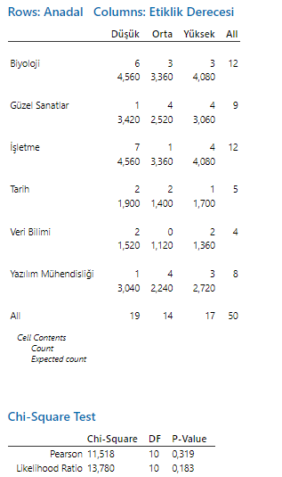

**[GİRİŞ]{.underline}**

> SPSS ve MINITAB üzerinde gösterilen bilgi ve becerileri kullanarak,
> öğretilen yöntemler çerçevesinde bulunan veri setleriyle çeşitli
> istatistiksel analizler gerçekleştirilecektir.
>
> Bu kapsamda planlanan analizler şunlardır:

1.  **[İki Örneklem Hipotez Testleri:]{.underline}** İki farklı grup
    arasındaki ortalamaların karşılaştırılması için hipotez testleri
    uygulanarak gruplar arasındaki farkları belirlenecektir.

2.  **[Güven Aralığı Yorumlama:]{.underline}** Elde edilen verilere
    dayanarak, bir parametrenin tahmini değerini içeren güven
    aralıklarını hesaplayarak sonuçları yorumlanacaktır.

3.  **[Uyum İyiliği Testi:]{.underline}** İstatistiksel bir modelin,
    gözlemlenen verilere ne kadar iyi uyduğunu değerlendirmek için uyum
    iyiliği testleri yaparak modelin uygunluğunu değerlendirilecektir.

4.  **[Gruplar Arası Fark Analizi:]{.underline}** Farklı kategorik
    gruplar arasındaki ortalama veya oran farklarını belirlemek için
    uygun istatistiksel testler uygulayarak gruplar arasındaki
    farklılıkları incelenecektir.

5.  **[Bağımsızlık Kontrolü:]{.underline}** İki veya daha fazla değişken
    arasındaki ilişkiyi belirlemek ve bu ilişkinin bağımsızlık
    hipotezini test etmek için uygun istatistiksel testler
    uygulanacaktır.

> Bu analizlerin sonuçları, veri setlerindeki değişkenler arasındaki
> ilişkileri anlamayı ve sonuçları doğru bir şekilde yorumlamayı
> sağlayacaktır.

---

**[Veri Elde Edilmesi]{.underline}**

<https://www.kaggle.com/datasets/sohaibdevv/ai-and-student-life-2026-the-new-normal?resource=download>

Bu analiz Kaggle'dan yapay zeka kullanımının öğrenciler üzerindeki
etkisini analiz etmek üzere ilk 50 öğrencinin verisi alınarak
yapılmıştır.

---

**[Tanımlayıcı İstatistikler]{.underline}**

{width="6.3in" height="2.6805555555555554in"}

Bu çıktıya göre 50 öğrencinin yaş, günlük yapay zeka kullanma sıklığı,
yapay zeka öncesi ve sonrası not ortalaması ve haftalık kazandıkları
süre olmak üzere 5 değişkenden oluşan temel istatistiksel gösterimleri
yer almaktadır.

---

1.  **[İki Örneklem Ortalaması için Hipotez Testi ve Güven
    Aralığı]{.underline}**

H~0~: ChatGPT kullanan öğrencilerin haftalık kazandığı süreyle Gemini
kullanan öğrencilerin haftalık kazandığı süre arasında fark yoktur.

H~1~: ChatGPT kullanan öğrencilerin haftalık kazandığı süreyle Gemini
kullanan öğrencilerin haftalık kazandığı süre arasında fark vardır.

n=18 olduğu için öncelikle varyans homojenliğini test etmek amacıyla ara
hipotez kurulur.

H~0~: $\sigma_{1}^{2} = \sigma_{2}^{2}$

H~1~:${\ \sigma}_{1}^{2} \neq \sigma_{2}^{2}$**[\
]{.underline}**

**[Çıktı]{.underline}**

{width="2.9833333333333334in"
height="4.475in"}

Levene testine göre p-değeri **0.094** olarak bulunmuştur. Bulunan bu
değer, belirlenen α=0.05 anlamlılık düzeyinden büyük olduğu için (0.094
\> 0.05) **H~0​~ hipotezi reddedilemez**.

**[Yorum]{.underline}**

%95 güven düzeyinde, Gemini ve ChatGPT kullanıcılarının kazandıkları
zaman sürelerine ait varyansların homojen olduğu sonucuna varılmıştır.

**[Çıktı]{.underline}**

{width="2.4585465879265094in"
height="4.62540135608049in"}

Minitab iki örneklem t-testi sonuçlarına göre **p-değeri 0.452** olarak
bulunmuştur. Bulunan bu değer, belirlenen α=0.05 anlamlılık düzeyinden
büyük olduğu için (0.452 \> 0.05) **H~0~​ hipotezi reddedilemez**.

**[Güven Aralığı]{.underline}**

\[-2.58 ; 5.53\]

Güven aralığı incelendiğinde, iki grubun ortalamaları arasındaki farkın
(-2.58; 5.53) değerleri arasında olduğu görülmektedir. Alt sınırın
negatif, üst sınırın ise pozitif olması sebebiyle **güven aralığı sıfır
(0) değerini kapsamaktadır**. Bu durum, iki kitle ortalaması arasında
istatistiksel olarak anlamlı bir fark olmadığı yönündeki test sonucunu
desteklemektedir.

**[Yorum]{.underline}**

%95 güven düzeyinde, Gemini ve ChatGPT kullanıcılarının kazandıkları
ortalama zaman arasında bir fark yoktur.

---

2.  **[İki Örneklem Varyansı için Hipotez Testi ve Güven
    Aralığı]{.underline}**

H~0~: Claude kullanan öğrenciler ile GitHub Copilot kullanan
öğrencilerin yapay zeka sonrası not ortalamalarının varyansları eşittir.

H~1~: Claude kullanan öğrenciler ile GitHub Copilot kullanan
öğrencilerin yapay zeka sonrası not ortalamalarının varyansları eşit
değildir.

**[Çıktı]{.underline}**

{width="3.100269028871391in"
height="4.5503947944007in"}

Minitab çıktısında yer alan test sonuçlarına göre, Levene testinin
**p-değeri 0.331** olarak bulunmuştur. Bulunan bu değer, belirlenen
α=0.05 anlamlılık düzeyinden büyük olduğu için (0.331 \> 0.05) **H~0~​
hipotezi reddedilemez**.

**[Güven Aralığı]{.underline}**

\[0.324 ; 1.592\]

Varyans oranına ait güven aralığı incelendiğinde, bu aralığın \"1\"
değerini kapsadığı açıkça görülmektedir. Oranın 1 olması, iki grubun
varyanslarının birbirine eşit olduğunu doğrulamaktadır.

**[Yorum]{.underline}**

%95 güven düzeyinde, Claude ve GitHub Copilot kullanıcılarının not
ortalamalarına ait varyansları arasında anlamlı bir fark yoktur.

---

3.  **[İki Örneklem Oranı için Hipotez Testi ve Güven
    Aralığı]{.underline}**

H~0~: İşletme öğrencileri ile Biyoloji öğrencileri arasında ChatGPT
kullanma oranları arasında fark yoktur.

H~1~: İşletme öğrencileri ile Biyoloji öğrencileri arasında ChatGPT
kullanma oranları arasında fark vardır.

**[Çıktı]{.underline}**

{width="2.325in" height="3.514682852143482in"}

> İşletme öğrencilerinin ChatGPT kullanım oranının %77.8, Biyoloji
> öğrencilerinin oranının ise %22.2 olduğu görülmektedir. Ancak grup
> örneklem hacimleri küçük olduğu için normal yaklaşıma dayalı Z-testi
> yerine küçük örneklemlerde daha güvenilir sonuç veren **Fisher\'s
> Exact Test** referans alınmıştır.
>
> Fisher\'in testine göre **p-değeri 0.057** olarak bulunmuştur. Bulunan
> bu değer, belirlenen α=0.05 anlamlılık düzeyinden büyük olduğu için
> (0.057 \> 0.05) **H~0​~ hipotezi reddedilemez**.

**[Güven Aralığı]{.underline}**

\[0.1714 ; 0.9396\]

Analiz sonucunda iki grup arasındaki farka ait güven aralığı **(0.171439
; 0.939672)** olarak bulunmuştur. Matematiksel olarak bu aralık 1
değerini kapsamadığı için iki grup arasında anlamlı bir fark olduğu
yanılgısını yaratabilir. Ancak Minitab çıktısında da belirtildiği üzere
(*\"CI based on normal approximation\"*), bu aralık normal dağılım
yaklaşımı kullanılarak hesaplanmıştır ve örneklem hacmimizin çok küçük
olması sebebiyle bu yaklaşım istatistiksel olarak **hatalı/yanıltıcı
sonuçlar** vermektedir.

**[Yorum]{.underline}**

%95 güven düzeyinde, İşletme öğrencileri ile Biyoloji öğrencileri
arasında ChatGPT kullanma oranları arasında fark yoktur.

---

4.  **[Bağımlı İki Örneklem Hipotez Testi ve Güven
    Aralığı]{.underline}**

H~0~: Öğrencilerin yapay zeka kullanımı öncesi ve sonrası not
ortalamaları arasında istatistiksel olarak anlamlı bir fark yoktur.

H~1~: Öğrencilerin yapay zeka kullanımı öncesi ve sonrası not
ortalamaları arasında istatistiksel olarak anlamlı bir fark vardır.

**[Çıktı]{.underline}**

{width="3.217361111111111in"
height="2.966666666666667in"}

Minitab bağımlı t-testi sonuçlarına göre **p-değeri 0.000** olarak
bulunmuştur. Bulunan bu değer, belirlenen 0.05 anlamlılık düzeyinden
küçük olduğu için **H~0~​ hipotezi kesin olarak reddedilir**. Bu durum,
öğrencilerin yapay zeka öncesi ve sonrası not ortalamaları arasında
istatistiksel olarak anlamlı bir fark olduğunu kanıtlamaktadır.

**[Güven Aralığı]{.underline}**

\[0.034 ; 0.1056\]

Matematiksel olarak bu aralığın alt ve üst sınırlarının her ikisi de
pozitif değerlerden oluştuğu için, aralık **0 (sıfır) değerini
kapsamamaktadır**. Güven aralığının sıfırı kapsamaması ve tamamen
pozitif bölgede yer alması, \"Yapay Zeka Sonrası\" notların, \"Yapay
Zeka Öncesi\" notlardan istatistiksel olarak anlamlı derecede yüksek
olduğunu açıkça göstermektedir.

**[Yorum]{.underline}**

%95 güven düzeyinde, yapay zeka araçlarını kullanmanın öğrencilerin
akademik not ortalamaları (GPA) üzerinde istatistiksel olarak anlamlı ve
pozitif bir etkisi olduğu kanıtlanmıştır.

---

1.  **[Uyum İyiliği Testi]{.underline}**

H~0~​: Öğrencilerin yapay zekayı etik bulma derecelerinin dağılımı ile
beklenen dağılım arasında fark yoktur.

H~1~​: Öğrencilerin yapay zekayı etik bulma derecelerinin dağılımı ile
beklenen dağılım arasında fark vardır.

**[Çıktı]{.underline}**

{width="4.333708442694663in"
height="2.683566272965879in"}

Ki-kare uyum iyiliği testi sonucuna göre **p-değeri 0,684** olarak
bulunmuştur. Bulunan bu değer, belirlenen anlamlılık düzeyinden büyük
olduğu için (0,684 \> 0,05) **H~0~ hipotezi reddedilemez**.

Tablodaki \"Observed\" (Gözlenen) ve \"Expected\" (Beklenen) değerleri
incelendiğinde; her bir kategori için beklenen kişi sayısı 16,66 iken,
gözlenen değerlerin (19, 14, 17) bu sayıya oldukça yakın olduğu
görülmektedir.

**[Yorum]{.underline}**

%95 güven düzeyinde, öğrencilerin yapay zeka konusundaki etik kaygı
düzeylerinin kitle içinde eşit (homojen) bir dağılım gösterdiği sonucuna
varılmıştır.

---

2.  **[Gruplar Arası Fark Testi]{.underline}**

H~0~: Biyoloji ve İşletme bölümlerindeki öğrencilerin yapay zeka aracı
tercihleri arasında fark yoktur.

H~1~: Biyoloji ve İşletme bölümlerindeki öğrencilerin yapay zeka aracı
tercihleri arasında fark vardır.

**[Çıktı]{.underline}**

{width="3.5586417322834647in"
height="4.417049431321085in"}

Yapılan Ki-kare testi sonucunda **p-değeri 0,191** olarak bulunmuştur.
Bulunan bu değer, belirlenen α=0,05 anlamlılık düzeyinden büyük olduğu
için (0,191 \> 0,05) **H~0​~ hipotezi reddedilemez**.

**[Yorum]{.underline}**

%95 güven düzeyinde, Biyoloji ve İşletme bölümlerinde okuyan
öğrencilerin yapay zeka aracı tercihleri arasında istatistiksel olarak
anlamlı bir fark bulunamamıştır.

---

3.  **[Bağımsızlık Kontrolü]{.underline}**

> H~0~: Öğrencilerin okudukları anadal ile yapay zekayı etik bulma
> dereceleri aralarında istatistiksel bir ilişki yoktur.
>
> H~1~: Öğrencilerin okudukları anadal ile yapay zekayı etik bulma
> dereceleri aralarında istatistiksel bir ilişki vardır.
>
> **[Çıktı]{.underline}**
>
> {width="2.641895231846019in"
> height="4.458719378827647in"}

Yapılan Ki-kare bağımsızlık testi sonucunda **p-değeri 0,319** olarak
hesaplanmıştır. Bu değer, belirlenen anlamlılık düzeyinden büyük olduğu
için (0,319 \> 0,05) **H~0~ hipotezi reddedilemez**.

**[Yorum]{.underline}**

%95 güven düzeyinde, öğrencilerin okudukları bölümler ile yapay zekayı
etik bulma dereceleri arasında istatistiksel olarak anlamlı bir ilişki
bulunamamıştır.

**[KAYNAKÇA]{.underline}**

https://www.kaggle.com/datasets/sohaibdevv/ai-and-student-life-2026-the-new-normal?resource=download
